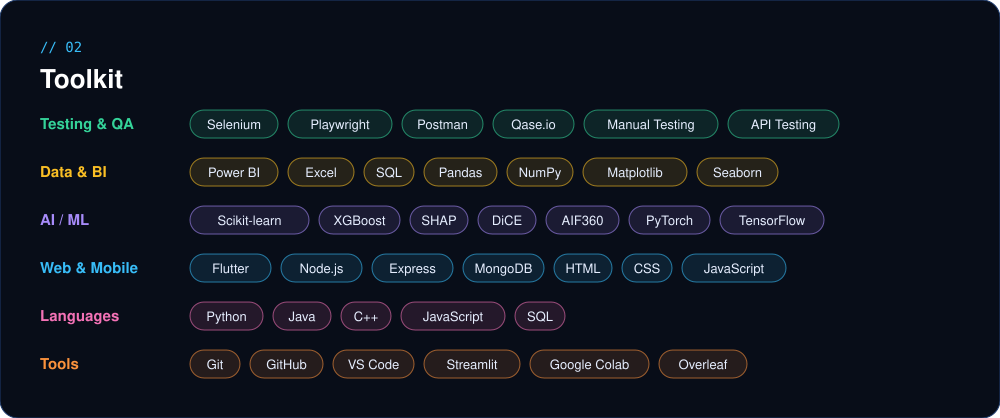

<!-- ========================= HERO ========================= -->

  

  
  
  
  

<!-- ========================= ABOUT ========================= -->

  

<!-- ========================= TOOLKIT ========================= -->

  

<!-- ========================= PROJECTS ========================= -->

<h2 align="center"><code>// 04</code> Featured Projects</h2>

<table align="center" width="96%">
<tr>
<td colspan="2" valign="top">
<h3>⚖️ Loan Approval System with Explainable AI &nbsp;<code>FINAL YEAR PROJECT · ONGOING</code></h3>
Flutter · Node.js · Express · Python · Scikit-learn · SHAP · DiCE · AIF360

A loan decision-support system for consumer microloans, built around transparency and fairness in credit decisions.

</td>
</tr>
<tr>
<td width="50%" valign="top">
<h3>🏥 SmartCare</h3>
Python · XGBoost · SHAP · Streamlit

Hospital disease-risk classification with SHAP explainability, a live Streamlit prototype, and a fairness gap found across age groups.

<a href="https://smartcare-ai-coursework.streamlit.app"><b>Live demo →</b></a>
</td>
<td width="50%" valign="top">
<h3>🕸️ OGBN-Arxiv GNN</h3>
PyTorch · PyTorch Geometric · Google Colab

GCN and GAT node classification on the OGBN-Arxiv citation dataset, trained on GPU with hyperparameter tuning.

<a href="https://github.com/kithmini26/CCS4354-OGBN-Arxiv-GNN"><b>Codebase →</b></a>
</td>
</tr>
<tr>
<td width="50%" valign="top">
<h3>🛒 Retail Sales Analysis</h3>
Python · Pandas · Matplotlib · Seaborn

Analysis of about 8,400 Superstore orders covering cleaning, feature engineering, and pricing, discount and logistics recommendations.

<a href="https://github.com/kithmini26/superstore-sales-analysis"><b>Codebase →</b></a>
</td>
<td width="50%" valign="top">
<h3>📚 Smart Library</h3>
Node.js · Express · MongoDB · Postman

Responsive library management system with search, filtering and borrow/return workflows, backed by Postman-tested REST APIs.

<a href="https://github.com/kithmini26/smart-library-website"><b>Codebase →</b></a>
</td>
</tr>
<tr>
<td colspan="2" valign="top">
<h3>🏙️ Utopia</h3>
JavaScript · HTML · CSS · Leaflet · Geolocation

Role-based smart city platform with emergency reporting, bill and tax payments, and location-based maps.

<a href="https://github.com/kithmini26"><b>Codebase →</b></a>
</td>
</tr>
</table>

<!-- ============== CERTIFICATIONS & LEADERSHIP ============== -->

<h2 align="center"><code>// 05</code> Certifications &amp; Leadership</h2>

<table align="center" width="96%">
<tr>
<td width="50%" valign="top">

**🎓 Certifications**

- Introduction to Software Testing — *Simplilearn*
- Introduction to Software Testing or Software QA — *Udemy*
- Power BI for Beginners — *Simplilearn*
- Power BI Data Modelling Basics — *Simplilearn*
- Cloud Computing Fundamentals — *Simplilearn*
- Fundamentals of Software Development — *Simplilearn*
- Software Engineer Intern — *HackerRank*
- SQL (Basic) — *HackerRank*

</td>
<td width="50%" valign="top">

**👑 IEEE CS SLTC**

- **Chairperson**, Student Branch Chapter (2025/26)
- Outstanding Executive Committee Volunteer Award (Aug 2026)
- Outstanding Project Award, Codemania v6.0 (Aug 2026)
- Membership Recruitment & Retention Award, under my chairpersonship (Aug 2026)
- IEEE SL SYW Congress 2025
- Project Co-Chairperson, Codemania v5.0
- Project Chairperson, GitGenius 2024

</td>
</tr>
</table>

<!-- ========================= ACTIVITY ========================= -->

  
  

  

<!-- ========================= CONNECT ========================= -->

  

  
  
  

